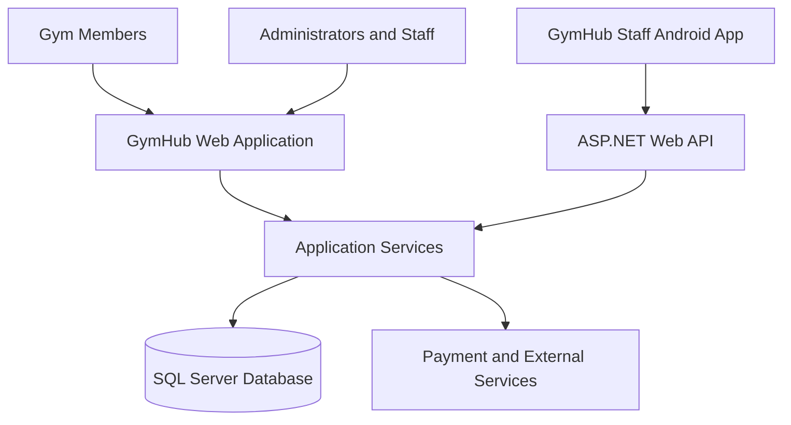
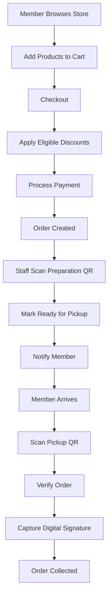

# 🏋️ GymHub — Gym Management System

### A Smart, Integrated Web & Mobile Solution for Modern Gym Management


**GymHub** is a comprehensive gym management platform developed by **Swift Tech (Group 15)**, a team of ten Information and Communication Technology students at **Durban University of Technology (DUT)**.

The project integrates membership administration, fitness tracking, nutrition management, equipment maintenance, online store operations, inventory control, payments, and mobile QR-code verification into one centralized system.

---

## 📑 Table of Contents

- [Project Overview](#-project-overview)
- [The Problem](#-the-problem)
- [Our Solution](#-our-solution)
- [Key Features](#-key-features)
- [Technology Stack](#-technology-stack)
- [System Architecture](#-system-architecture)
- [Gym Store Workflow](#-gym-store-workflow)
- [User Roles](#-user-roles)
- [Project Screenshots](#-project-screenshots)
- [Getting Started](#-getting-started)
- [Development Team](#-development-team)
- [Academic Information](#-academic-information)

---

## 🎯 Project Overview

GymHub is designed to digitize and streamline gym operations by replacing fragmented manual processes with an integrated web and mobile platform.

The system supports gym administrators, members, trainers, technicians, and store staff through role-specific interfaces and workflows.

**Project objectives:**

- Centralize gym administration and operational data.
- Reduce manual paperwork and administrative errors.
- Automate membership and payment-related processes.
- Improve equipment maintenance and inspection tracking.
- Support members' fitness and nutritional goals.
- Digitize gym store purchases and inventory management.
- Improve accountability through transaction records and audit trails.
- Provide convenient access through web and mobile technologies.

---

## ❗ The Problem

Traditional gym management often relies on separate spreadsheets, paper registers, cashbooks, and maintenance notebooks.

These approaches can lead to:

- Inaccurate membership and payment records.
- Delays in identifying and repairing faulty equipment.
- Inefficient inventory management.
- Difficulty monitoring members' fitness progress.
- Manual order preparation and collection procedures.
- Limited operational visibility for administrators.

GymHub addresses these challenges through a centralized digital management platform.

---

## 💡 Our Solution

GymHub combines several essential gym operations into one connected ecosystem.

The web application provides interfaces for administration, membership services, fitness management, store operations, and reporting.

The Android staff application supports selected operational tasks, including QR-code scanning, order preparation verification, and collection confirmation.

Together, these components improve efficiency, transparency, and the overall gym experience.

---

## 🚀 Key Features

### 1. Membership & Payment Management

- Member registration and profile management.
- Unique member identification.
- Membership subscriptions and renewals.
- Membership freezing and cancellation.
- Payment processing and transaction records.
- Refund management.
- QR-based member check-in and attendance tracking.

### 2. Fitness & Training Management

- Personalized fitness goals.
- Trainer assignment.
- Workout program management.
- Personal training session booking.
- Workout and fitness progress tracking.
- Member attendance and performance reporting.

### 3. Nutrition & Diet Management

- Meal logging and nutritional calculations.
- Tracking calories, protein, carbohydrates, and fats.
- Meal analysis using food images or manual entry.
- Personalized meal plan generation.
- Dietary preferences and allergy considerations.
- Fitness and nutrition progress monitoring.

### 4. Equipment & Maintenance Management

- Equipment registration and tracking.
- Fault reporting.
- Repair assignment to technicians.
- Repair diagnosis and progress management.
- Repair verification.
- Equipment safety inspections.
- Scheduled preventive maintenance.
- Maintenance history and audit records.

### 5. Gym Store & Inventory Management

- Online product catalogue.
- Shopping cart and checkout.
- Membership-based discounts.
- Payment integration.
- In-store pickup orders.
- QR-code order verification.
- Digital signature capture at collection.
- Uncollected-order monitoring.
- Return and exchange requests.
- Return inspection and approval workflows.
- Supplier purchase orders.
- Stock delivery inspections.
- Damaged stock returns.
- Promotions for products approaching expiry.

### 6. GymHub Staff Android Application

The companion Android application supports store staff with selected operational workflows.

**Order preparation**
1. Scan an order preparation QR code.
2. Retrieve the order details.
3. Verify the order.
4. Mark the order as ready for pickup.

**Order collection**
1. Scan the member's pickup QR code.
2. Verify the order and collection eligibility.
3. Capture the member's digital signature.
4. Confirm collection.
5. Update the order status.

This provides an additional verification layer between online purchases and physical collection.

### 7. Reporting & Analytics

- Membership and attendance reporting.
- Payment and transaction records.
- Equipment maintenance monitoring.
- Store sales and inventory reporting.
- Operational dashboards and activity tracking.

---

## 🛠 Technology Stack

| Layer | Technologies |
|---|---|
| Backend | C#, ASP.NET MVC 5, ASP.NET Web API |
| Framework | .NET Framework 4.7.2 |
| Frontend | HTML5, CSS3, JavaScript, Razor, Bootstrap |
| Database | Microsoft SQL Server |
| ORM | Entity Framework 6 |
| Mobile Application | Android, Kotlin |
| Mobile Networking | REST API |
| Cloud Hosting | Microsoft Azure |
| Payment Integration | Paystack |
| Development Tools | Visual Studio, Android Studio |
| Version Control | Git & GitHub |

Additional libraries and services are used for QR-code processing, notifications, document generation, and reporting.

---

## 🏗 System Architecture

GymHub follows a connected web, mobile, API, and database architecture.



**Architecture components:**

- **Web application:** Provides member and staff interfaces.
- **Android application:** Supports mobile operational workflows.
- **Web API:** Handles communication between the Android app and backend.
- **Business logic:** Processes membership, payment, inventory, and operational rules.
- **Database:** Stores application records and transaction history.
- **External integrations:** Support payments and selected automated services.

---

## 🛒 Gym Store Workflow

One of GymHub's major features is its integrated online purchasing and in-store collection process.



### Uncollected Orders

The system also monitors orders that have not been collected within the permitted collection period.

This includes reminder notifications, deadline monitoring, and uncollected-order resolution.

### Returns and Exchanges

Members can submit eligible return or exchange requests.

Store staff inspect returned products, while the appropriate approval workflow determines the outcome and any necessary inventory or refund updates.

---

## 👥 User Roles

| Role | Main Responsibilities |
|---|---|
| Member | Manage membership, fitness activities, nutrition, and store purchases |
| Administrator | Manage gym operations, approvals, reporting, and oversight |
| Trainer | Manage training programs, sessions, and member progress |
| Technician | Manage assigned repairs and equipment inspections |
| Store Staff | Manage products, orders, stock, collections, and returns |

---

## 📸 Project Screenshots

Screenshots of the completed system will be added to showcase its main interfaces.

**Planned gallery:**

- Administrator dashboard
- Member dashboard
- Membership and payment management
- Nutrition tracking and meal plans
- Equipment maintenance
- Gym store catalogue
- Store staff dashboard
- Android QR-code scanner
- Order collection and signature confirmation
- Inventory and purchase order management

---

## ⚙ Getting Started

### Prerequisites

- Visual Studio with ASP.NET development support.
- .NET Framework 4.7.2 development tools.
- SQL Server or SQL Server LocalDB.
- Entity Framework 6 dependencies.
- Git.
- Android Studio for the companion Android application.

### Clone the Repository

```bash
git clone https://github.com/Lesebo-Tech/GymHub.git
cd GymHub
```

### Web Application Setup

1. Open `SwiftyS26.sln` in Visual Studio.
2. Restore the project's NuGet packages.
3. Configure a local `Web.config` file with the required database connection and application settings.
4. Configure the database and apply the required Entity Framework migrations.
5. Build the solution.
6. Run the web application through IIS Express.

**Important:** Real credentials, connection strings, payment secrets, and deployment profiles are not included in the repository.

A valid local configuration is required to run the application.

### Android Application Setup

The companion Android application requires its Android project files and an accessible GymHub Web API endpoint.

The Android source project may be maintained separately from the web application repository.

---

## 👨‍💻 Development Team

**Swift Tech — Group 15**

GymHub was developed collaboratively by a team of ten students from Durban University of Technology.

| Team Member |
|---|
| Lindani Buthelezi |
| Sisanda Dlungwane |
| Sisanda Kgotshane |
| Sixwayisile Khumalo |
| Mkhululi Langa |
| Owami Mashiya |
| Ziyanda Mgobhozi |
| Sthabiso Mfekayi |
| Andiswa Ngcamu |
| Siphesihle Phewa |

Development responsibilities were distributed across different business processes and use cases, including membership management, training, payments, maintenance, nutrition, and store operations.

The project followed an incremental development approach, with features developed, integrated, and demonstrated across academic project milestones.

> Individual contributions and GitHub profile links can be added after the team confirms the final contribution records.

---

## 🎓 Academic Information

| Field | Details |
|---|---|
| Institution | Durban University of Technology |
| Qualification | Diploma in ICT — Application Development |
| Project | Applications Development Project III |
| Academic Year | 2026 |
| Group | Group 15 |
| Team Name | Swift Tech |
| Project Name | GymHub |
| Domain | Health & Fitness |

---

## 🌟 Project Highlights

GymHub demonstrates practical experience in:

- Full-stack web application development.
- Object-oriented programming using C#.
- Relational database design and management.
- RESTful API development and integration.
- Android application development.
- Role-based application workflows.
- Payment processing integration.
- QR-code-based verification.
- Inventory and order lifecycle management.
- Cloud deployment.
- Software requirements analysis.
- Collaborative software development.

---

## 📌 Project Status

**Academic project implementation completed.**

GymHub was developed and demonstrated as part of the team's final-year application development coursework.

Future enhancements may include improved mobile support, additional automated reporting, and further production-readiness improvements.

---

## 🙏 Acknowledgements

Special thanks to the Durban University of Technology, the Applications Development Project lecturers, project stakeholders, and every Swift Tech team member for their contributions throughout the development process.

---

**Developed by Swift Tech | Durban University of Technology | 2026**

*GymHub — Bringing gym operations together in one connected platform.*
